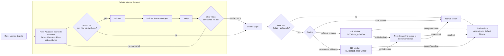

# RydeResolve: multi-agent dispute resolution for Ryde

**Three AI agents argue it, the affected party can challenge it, and code handles the money.**

Ride-hailing disputes (no-show fees, longer routes) take support teams 24–72 hours of manual review across GPS, chat, fare and policy records, and similar cases end with different rulings. RydeResolve resolves standard disputes in seconds. A Rider Advocate, a Driver Advocate and a Judge reason over read-only evidence tools. Deterministic engines own validation, confidence, deadlines and refunds. Humans review only the cases that are unsafe to automate.

Built for the **AI CAN DO IT · Tencent Cloud Hackathon Singapore 2026**, Digital Native track (Ryde): *Multi-Agent Autonomous Dispute Resolution System*.

## How a dispute flows



**How the debate works.** Every dispute is debated. Each round, the Rider Advocate gathers evidence from the rider's side (complaint, rider profile and history, fare breakdown, rider uploads) and the Driver Advocate from the driver's side (driver GPS, driver profile and history, driver uploads); the trip record, policy and platform logs (chat, app events, navigation) are shared. Both argue, the Policy & Precedent Agent advises, and the Judge rules. A clear ruling with confidence ≥ 0.85 ends the debate. Otherwise the next round must bring new trip evidence; if neither advocate finds any at the start of a round, the debate stops. At most three rounds. In the demo a no-show is usually settled in round 2 (chat and app events), a route dispute in round 3 (navigation alternatives).

**Who may challenge?** Only the party adversely affected by the preliminary decision. A refund affects the Driver; an upheld charge affects the Rider.

**What if evidence is insufficient?** The agents still issue a preliminary decision from the verified records, but the window opens in `EVIDENCE_REQUIRED` mode:

- the affected party can challenge **only by uploading a document**; free text is not admitted;
- a document that matches the trusted trip source re-opens the case: both Advocates rebut with the new records and the final Judge rules;
- an unverifiable document goes to a human reviewer;
- no evidence by the deadline means the burden was not met, so the preliminary decision stands (`basis: BURDEN_NOT_MET`). Such outcomes are never used as precedents. Set `EVIDENCE_REQUIRED_TIMEOUT=human_review` to route these cases to a reviewer instead.

If no preliminary liability can be determined at all (for example, the platform's own navigation records are missing), there is no affected party, so the case goes to human review.

## The agents

| Agent | Does | Cannot |
|---|---|---|
| **Rider Advocate** | Chooses which read-only tools to call (trip, GPS, chat signals, fare breakdown, history, policy, precedents) and argues the rider's case with cited evidence IDs | Mutate data, calculate money, cite evidence it did not retrieve |
| **Driver Advocate** | Same, for the driver: arrival, waiting, contact attempts, route choice | Same |
| **Communication Analyst** | Reads the whole trip chat once per case and labels what each message means: whether the driver announced a reroute (in English, Singlish, Chinese or Malay), whether a reason was given, whether the rider agreed. Every agent and validator uses the same reading | Decide who sent a message or when: sender and timing are checked in code, so a label cannot move a notice before the deviation. If the model is unavailable or below 0.7 confidence, the case goes to a person (`REROUTE_NOTICE_UNCERTAIN`); there is no keyword fallback. Offline runs use a keyword stand-in for tests only |
| **Policy & Precedent Agent** | Runs before every Judge ruling: selects the policy version in force at the trip time, retrieves comparable past rulings (with the facts that differ), recommends an outcome and surfaces reviewer corrections awaiting approval | Decide liability; the Judge must follow its recommendation or name the facts that make the case different |
| **Judge** | Weighs both validated arguments, applies the pinned policy, returns liability, reason codes, a reviewer summary and plain-language explanations for each party | Calculate money; automate anything the policy rule disagrees with |

**Learning feedback.** When a reviewer overrides an automated outcome, it is saved as a correction awaiting policy-owner approval. Until approved, identical cases go to a person; once approved, it becomes a high-authority precedent. Five labelled synthetic past rulings ship with the demo so precedent retrieval is visible from the first case.

Everything else is deterministic code: validators, confidence engine, challenge gate, debate progress checker, policy-version selector, precedent consistency check, Refund Engine, deadlines.

## Guardrails (Responsible AI)

- **Grounding.** Every factual claim must cite evidence IDs the agent actually retrieved, and the cited records must entail the claim's value. Unsupported claims are rejected.
- **Dual-key automation.** The Judge's liability and reasons are compared with an independent deterministic policy rule. If they disagree, the case goes to human review with both views shown (`JUDGE_RULE_DISAGREEMENT`).
- **Narrative guards.** Agent prose may not contain money amounts or unknown evidence IDs.
- **Money is code.** The Refund Engine computes refunds in integer cents from verified pricing and machine-readable policy rules, with idempotency keys and a calculation trace.
- **History is context only.** Rider and driver history adjusts a 10% reliability factor and corroboration needs. It never decides liability.
- **Safety first.** Threats in chat or the complaint go straight to human review and block any timeout closure.
- **Prompt-injection hygiene.** Chat, complaints and uploads are treated as data, never as instructions. Tools are whitelisted, parameterised and scoped to the case.
- **Bounded autonomy.** At most 3 debate rounds, 12 tool turns per agent and one JSON repair turn. Any provider failure escalates to human review; there is no silent fallback to rules.

## Policy

All decisions apply the official **Ryde Dispute Resolution Policy v2.1** (23 clauses in `backend/data/policy_seed.json`): the 5-minute free wait from the scheduled pickup time, the S$5 no-show fee, the message-AND-call contact obligation, the route refund matrix (1 km tolerance, rider notification, traffic justification) and the ruling thresholds (route deviations above 2 km and fraud-flagged accounts below 95% confidence go to a person; AI never rules on safety). The earlier Help Center articles stay in the knowledge base; where they conflict with v2.1 the conflict is recorded and v2.1 prevails. See [docs/policy-gap-analysis.md](docs/policy-gap-analysis.md). The organisers' DISP-002 sample keeps its own sample policy; their DISP-001 route sample is decided under v2.1.

## Test data

The system runs on **100 synthetic test cases** generated from policy v2.1: 50 cases (`scripts/generate_benchmark.py`) covering all 33 scenario groups, and a hard variant of each (`scripts/generate_hard_variants.py`), plus the organisers' two official samples:

| Set | Cases | What they cover |
|---|---|---|
| 25 `BM-NS` no-show | 9 simple, 16 complex | proper waits; short waits; late drivers; message-without-call; GPS away from the pin; pickup changes (server-confirmed or not); phone-clock timing; fraud history; safety threats; missing contact records |
| 25 `BM-RD` route deviation | 12 simple, 13 complex | recommended route; within 1 km; informed reroutes; uninformed reroutes with or without a traffic incident; deviations above 2 km; missing navigation; route/fare conflicts; safety |

| `DISP-002` official no-show | 1 | the organisers' no-show sample, with its own sample policy |
| `DISP-001` official route deviation | 1 | the organisers' route sample: 24.8 km driven against a 20.5 km recommended route, a traffic incident on the expressway, no reroute notice to the rider |

The official sample files also contain the organisers' expected ruling and written analysis. `backend/app/official_samples.py` loads only the raw records: it drops `case_metadata`, `recommended_ruling`, `evidence_summary`, `traffic_analysis`, `chat_log_analysis` and the fare note, removes evaluative sentences from the traffic descriptions, and marks every field it derives to fit the evidence schema (navigation routes, app events). For DISP-001 the system reaches the expected **S$3.44 partial refund** (the excess-distance fare) on its own, but routes the case to a person: v2.1 §6.2 lets the AI rule on route deviations only up to 2 km, and this one is 4.3 km. `scripts/run_benchmark.py` scores DISP-001 separately from the test cases.

**Hard variants** (`HD-NS`, `HD-RD`, `scripts/generate_hard_variants.py`): the same 50 cases with the same facts and expected answers, written the way real trips look. Every chat message is reworded by hand with the same meaning in Singlish, Chinese, Malay-English, casual English or with typos; 8 route cases where the driver gave no notice get a driver complaint about traffic (a complaint is not a notice); GPS points move by up to 8 m; record order is shuffled. Run `python scripts/run_benchmark.py --set hard`. The offline keyword readers drop from 100% to 78% outcome accuracy here (route liability 36%): reroute notices in Singlish or Chinese are missed (6 cases), traffic complaints are taken as notices (2), and reworded threats are not flagged for safety review (3). This is the gap the LLM agents are meant to close.

Each case holds only raw records: trip, GPS, chat and calls, app events, navigation routes, traffic incidents, fare breakdown and profiles. No record states a conclusion, and the expected answers are stored separately for scoring only.

`BM-NS-027` and `031` ship a server export the rider can upload: the pickup-pin change that never synced. They demonstrate the evidence-required challenge.

**Five-minute walkthrough:** In the Rider app, submit `BM-NS-027`. The agents uphold the fee provisionally but flag the unsynced pickup change, so only the Rider may challenge, and only with evidence. Open the Driver app to see that the Driver cannot act. Back in the Rider app, click *Download demo server export*, upload it and submit the challenge. Open Admin → *Debate rounds* to watch the advocates argue with the new evidence and the Judge reverse the fee. Submit `BM-NS-031` and use Admin → *Skip ahead 12 hours* to see the burden-not-met path, then try `BM-RD-022` (a 3.3 km uninformed detour that v2.1 sends to a person).

## Run it

Requires Python 3.11+.

```bash
python -m venv .venv
source .venv/bin/activate            # Windows: .\.venv\Scripts\Activate.ps1
pip install -r backend/requirements.txt
python -m uvicorn app.main:app --app-dir backend --host 127.0.0.1 --port 8000
```

Open http://127.0.0.1:8000/rider, `/driver` and `/admin`. The API docs are at `/docs`. Each browser gets an isolated, signed demo workspace in which you can switch between the three roles (an identity stub, not production login). All trip evidence is loaded from `backend/data/` at startup; no database file is needed.

### Connect a real model

The agents run on a real LLM when `AGENT_MODE=llm`. Settings live in `backend/.env` (never committed; start from `backend/.env.example`). Two ways to connect:

**A. WorkBuddy Cloud (keyless).** Activate the WorkBuddy Cloud service for this project in WorkBuddy Desktop; it fills `llm-proxy/proxy-config.json` (also never committed). Then:

```bash
cd llm-proxy && npm install && npm start      # OpenAI-compatible proxy on http://127.0.0.1:8877
```

```bash
AGENT_MODE=llm
LLM_API_STYLE=chat_completions
LLM_BASE_URL=http://127.0.0.1:8877
LLM_MODEL=proxy                                # first enabled model; or set LLM_PROXY_MODEL for the proxy
LLM_API_KEY=local-proxy-no-key-needed
```

**B. Any OpenAI-compatible API** (Tencent Hunyuan, DeepSeek on Tencent LKE, OpenAI, ...): set `LLM_BASE_URL`, `LLM_MODEL` and `LLM_API_KEY` from your provider console. The model must support function calling: the advocates gather evidence through tools.

Check the connection, then run one dispute with the real model:

```bash
python scripts/llm_check.py           # config, JSON reply, tool-call round trip
python scripts/llm_check.py --case    # one full dispute: debate rounds, Judge ruling, model calls and tokens
```

Without these settings the app runs fully offline with deterministic agents that follow the same contracts. Provider errors never fall back silently: the case goes to a person.

## Tests and benchmark

```bash
cd backend && python -m unittest discover -s tests -p "test_*.py"    # 130 tests, about 2 minutes
python scripts/run_benchmark.py                                         # 50 test cases, scored (--set hard for the hard variants)
AGENT_MODE=llm python scripts/run_benchmark.py --limit 10               # same, with the real model
python scripts/generate_benchmark.py                                    # regenerate the benchmark data
```

The suite covers the challenge-window rules, both evidence branches, idempotent settlement under concurrency, tampered uploads, prompt injection, policy-version pinning, precedent feedback, and the LLM path end to end with a scripted model (tool loop, JSON repair, dual-key disagreement, money-in-narrative rejection).

**Benchmark.** 50 synthetic cases (25 no-show, 25 route deviation, every scenario group) plus their 50 hard variants, with expected outcomes written from policy v2.1. The app never sees the answers: they live only in `docs/benchmark-expected.json`, read by the scoring script. Each case is scored on the **outcome** (automated ruling or hand-off to a person) and on the Judge's **liability recommendation**. Deterministic mode currently scores 50/50 on both, with every refund amount correct — but because the rules engine and the expected answers were written from the same policy, that number measures how faithfully the policy is implemented, not judgement. **The meaningful number is the LLM-mode score** ([docs/benchmark-results.json](docs/benchmark-results.json) after an LLM run).

## Repository layout

```
backend/app/
  main.py              FastAPI routes, signed demo identity, challenge/accept/upload endpoints
  workflow.py          compiled LangGraph: assessment, routing, debate loop, final Judge
  rider_agent.py  driver_agent.py  judge_agent.py  agent_shared.py   the three agents + LLM tool loop
  tools.py             whitelisted read-only evidence tools (trip, GPS, chat, chat signals, fare breakdown, history, policy, precedents)
  engines.py           facts, validators, liability rule, confidence, routing
  narrative.py         plain-language narratives + narrative guards
  settlement.py        challenge windows, human-review routing, idempotent Refund Engine
  evidence_intake.py   uploads, trusted-source verification, challenge gate
  knowledge.py         versioned policies, structured precedent retrieval, consistency check
  chat_analysis.py  history.py  provenance.py  simulation.py  store.py (SQLite)
frontend/              dependency-free HTML/CSS/JS: Rider, Driver and Admin views
scripts/               benchmark and HTTP smoke
archive/               notes and validation artefacts from earlier iterations
```

## Limitations (honest scope)

This is a hackathon demo. Data is synthetic or sample data, and policy effective dates are synthetic. Notifications and payments are mocked, and the 12-hour window runs on a virtual clock. Storage is single-process SQLite. Precedent retrieval is structured, not vector-based. The chat analyzer is a lexical demo, not a production classifier. Image evidence (damage/mess claims) is out of scope. Real-model quality has not yet been measured on a labelled set.
