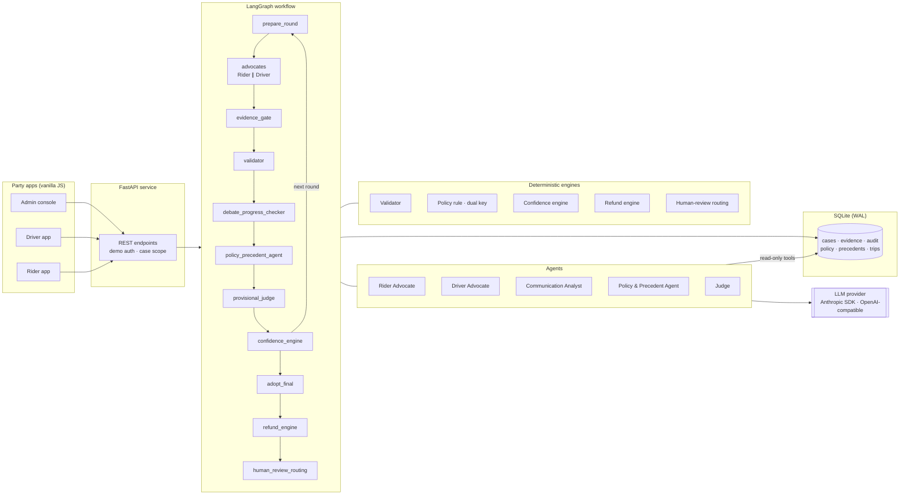
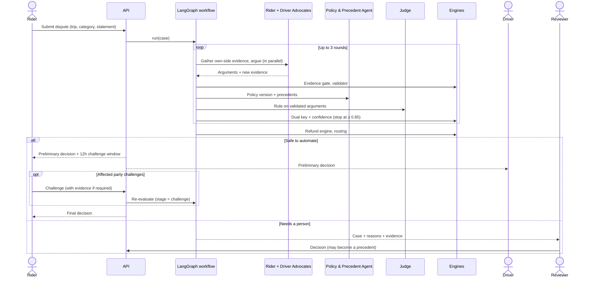

# RydeResolve — Technical Design

*Multi-agent dispute resolution for Ryde. Tencent Cloud AI Hackathon Singapore 2026, Digital Native track.*
*Reflects the code at commit `aaa6b9c` and later (14 October 2026).*

---

## 1. Overview

Ride-hailing disputes such as no-show fees and longer-than-expected routes are slow to resolve by hand. A support agent has to read GPS traces, chat logs, app events, fare ledgers and the policy, and similar cases often end with different rulings.

RydeResolve settles a standard dispute in seconds and hands the rest to a person with the evidence already organised. Two advocate agents argue opposite sides from evidence they gather themselves. A Judge rules on validated arguments only. Deterministic engines own everything that must not be left to a model: evidence validation, confidence, deadlines, money and the decision to involve a human.

**Design principles**

| Principle | What it means in the code |
|---|---|
| Agents argue, engines decide what is allowed | LLMs read evidence and reason; validators, the policy rule, the refund engine and routing are plain code |
| Every claim is checkable | A claim is a `(kind, value, evidence_ids, policy_ids)` tuple; the validator recomputes the value from the cited records |
| Two keys before automation | The Judge's ruling must match an independent deterministic policy rule, or the case goes to a person |
| AI never touches money | Refund amounts come only from the Refund Engine, from liability and the bound policy clause |
| Fail towards people | Provider errors, low confidence, safety, deviations above 2 km and fraud flags below 95% confidence all route to human review; there is no silent fallback |
| Both parties can contest | The party affected by a preliminary decision gets a challenge window before it becomes final |

---

## 2. Solution architecture



| Layer | Technology | Files |
|---|---|---|
| Party apps | HTML, CSS, vanilla JS: Rider, Driver and Admin apps served by the API | `frontend/` |
| API | FastAPI, Pydantic contracts, per-session demo auth with role tokens | `backend/app/main.py`, `contracts.py`, `demo_auth.py` |
| Orchestration | Compiled LangGraph `StateGraph` for the debate, a second graph for challenges | `workflow.py`, `challenge_graph.py` |
| Agents | Rider and Driver Advocates, Communication Analyst, Policy & Precedent Agent, Judge | `rider_agent.py`, `driver_agent.py`, `communication_analyst.py`, `precedent_agent.py`, `judge_agent.py`, `agent_shared.py` |
| Tools | Role-scoped, read-only evidence tools | `tools.py` |
| Engines | Facts, validation, policy rule, confidence, refund, routing, safety and history signals | `engines.py`, `settlement.py`, `provenance.py`, `knowledge.py`, `narrative.py` |
| Storage | SQLite with WAL, per-thread connections, 23 tables | `store.py` |
| LLM transport | Anthropic Messages API (official SDK) or any OpenAI-compatible Chat Completions or Responses API | `llm_provider.py` |

---

## 3. Core agent features

Each agent has one job, a fixed set of tools and a structured output that code validates. In `AGENT_MODE=llm` the agents call a model. In `AGENT_MODE=deterministic`, rule-based stand-ins produce the same output shapes offline, for tests and demos.

### 3.1 Rider Advocate and Driver Advocate

| | |
|---|---|
| **Job** | Argue one party's side from evidence the advocate gathers itself |
| **Runs** | Every round; both advocates run **in parallel** on the same starting case file |
| **Tools** | Shared: dispute, trip, policy, chat, chat signals, message labels, app events, navigation, traffic, pairwise history, own-party history, own-party uploads. Rider only: rider profile, fare breakdown. Driver only: driver GPS, driver profile |
| **Output** | `Argument`: position, claims `(kind, value, evidence_ids, policy_ids)`, rebuttal claim ids, and a 2–4 sentence plain-language summary with no money amounts |
| **How it is used** | Round 1 reads the core facts. Round 2 and later must bring **new trip evidence**, such as communications, app events or navigation. From round 2 each advocate sees the other's previous argument, only to rebut it |

**Independence.** Within a round neither advocate sees the other's argument or newly found evidence. An advocate can read only its own party's history and uploads. Claim IDs are assigned by the system from kind and value, so they cannot be forged.

**Format correction.** The prompt lists, for each claim kind, the value format and the source tables to cite, generated from the same table the validator uses. A schema-valid argument that still fails validation is sent back **once**, with each error explained in plain words. The workflow then validates the final answer independently.

### 3.2 Communication Analyst

| | |
|---|---|
| **Job** | Read the trip chat by meaning: did the driver announce a reroute, give a reason, did the rider agree or object |
| **Runs** | Once per case, on the whole conversation; labels are cached per message |
| **Input** | Chat messages only: no complaint, no party arguments, no indication of which side is asking |
| **Output** | Per message: `notice`, `reason`, `agrees`, `objects`, `confidence` |
| **How it is used** | Feeds the v2.1 reroute-notice fact (§1.2) used by the validator and the policy rule. Both advocates can read it through `get_message_labels`; it is the same for both sides and never counts as new trip evidence |

**Guardrails.** The model labels meaning only. Sender and timing are checked in code: a notice must come from the driver, as a message, at or before the deviation. If the model is unavailable, or any label has confidence below 0.7, the fact becomes `reroute_notice_uncertain` and the case goes to a person (`REROUTE_NOTICE_UNCERTAIN`). There is no keyword fallback in LLM mode. Chat text is treated as data: the prompt tells the model to ignore instructions inside messages.

### 3.3 Policy & Precedent Agent

| | |
|---|---|
| **Job** | Before every Judge ruling, select the policy version in force at trip time and retrieve comparable past rulings |
| **Tools** | `search_policy`, `search_precedents` |
| **Output** | Applicable policy references, up to three precedents with the facts that differ, a recommended outcome and its strength (`EXACT_MATCH`, `SIMILAR`, none) |
| **How it is used** | The Judge must either follow the recommendation or mark the ruling `DISTINGUISHED` and name the facts that differ |

Precedent retrieval scores only on the feature keys that two cases share. Reviewer corrections become precedents only after an administrator approves them.

### 3.4 Judge

| | |
|---|---|
| **Job** | Weigh both validated arguments and rule on liability |
| **Input** | Compacted evidence, required policy ids, both arguments, history context, the precedent recommendation |
| **Output** | `Verdict`: liability (`refund`, `charge_upheld`, `undetermined`), reason codes, evidence and policy ids, a reviewer summary, plain explanations for rider and driver, precedent alignment |
| **How it is used** | Provisional ruling each round; the last one becomes the preliminary decision shown to the parties |

**Dual key.** An independent deterministic policy rule (`engines.liability_rule`) recomputes liability from the evidence the Judge cited. Automation needs the same liability, and the Judge's reasons must include every reason the rule gives; the Judge may add supporting reasons. Otherwise the case goes to a person (`JUDGE_RULE_DISAGREEMENT`) with both views shown. The Judge's one format-correction turn reports format errors only: uncited records, money in text, missing policy ids or an unexplained departure from precedent. **It never reveals the rule's outcome**, so the two keys stay independent.

### 3.5 Deterministic engines

| Engine | Responsibility |
|---|---|
| **Facts** (`engines.facts`) | Derives wait time, driver lateness, contact counts, GPS presence, deviation in km, reroute notice, traffic incident and excess-distance fare from raw records |
| **Evidence gate** | From round 2, a round is held only if an advocate brought new trip evidence. Background sources such as policy, profiles, history, chat signals and message labels do not count |
| **Validator** | Schema, role, evidence ids, provenance and payload hashes, policy citations, claim values recomputed from cited records, aggregate citation completeness, and narrative guards (no money amounts, no unknown evidence ids) |
| **Policy rule** | Ryde Dispute Resolution Policy v2.1 as code: the no-show matrix and route refund matrix, plus ruling thresholds |
| **Confidence engine** | `0.30 policy clarity + 0.35 evidence strength + 0.15 historical consistency + 0.10 agent agreement + 0.10 claim reliability`. A ruling stops the debate at ≥ 0.85 with a determined liability. This is an engineering score, not a calibrated probability |
| **Refund engine** | Computes the amount from liability and the bound clause: cancellation-fee reversal, the v2.1 excess-distance fare (tolls are never refunded) or the fixed-fare excess. It never defaults an amount, and no payment is executed |
| **Human-review routing** | Collects every reason a case needs a person: hard blockers, validation failure, dual-key disagreement, provider errors, safety, thresholds |
| **Safety signals** | Flags threats in chat and always routes them to a person. *Currently keyword-based; see §11* |

### 3.6 Policy v2.1 rules in the engine

| Area | Rule |
|---|---|
| No-show wait | 5-minute free wait from the scheduled pickup time, or from arrival if the driver was late; the fee applies only after more than 5 minutes |
| Driver late | More than 5 minutes late means the fee is reversed |
| Contact | At least one message **and** one call before cancelling |
| Route | 1 km tolerance. Rider informed before the deviation: no refund. Not informed: refund the excess-distance fare, partial if a traffic incident justified the reroute and full if nothing did |
| Thresholds | Route deviations above 2 km go to a person. Fraud-flagged accounts need confidence ≥ 0.95. AI never rules on safety |

---

## 4. How it is used

### 4.1 End-to-end flow



### 4.2 The debate

| Round | Rider Advocate gathers | Driver Advocate gathers | Typical outcome |
|---|---|---|---|
| 1 | Dispute, trip, rider profile, fare breakdown, policy | Dispute, trip, driver GPS, driver profile, policy | Clear cases settle here |
| 2 | Chat, chat signals, app events, own history, own uploads | Same, from the driver side | Most no-show cases settle here |
| 3 | Navigation routes, pairwise history | Navigation, traffic conditions, pairwise history | Route cases settle here |

The debate stops when: the Judge rules with confidence ≥ 0.85 and a determined liability (`RESOLVED_WITH_CONFIDENCE`); no advocate brings new evidence at the start of a round (`NO_NEW_EVIDENCE_AT_ROUND_START`); validation fails; or three rounds are reached (`HARD_MAX_3_ROUNDS`).

### 4.3 The challenge window

After a preliminary decision, the affected party has 12 hours (simulated clock in the demo):

| Mode | When | What the affected party can do |
|---|---|---|
| `DECISION_REVIEW` | The decision rests on complete evidence | Accept, or challenge on factual, policy or evidence grounds |
| `EVIDENCE_REQUIRED` | The decision rests on evidence the affected party could correct, such as an unsynced pickup change or phone-clock timing | Challenge **only with evidence**. With no evidence by the deadline the decision stands (`BURDEN_NOT_MET`); set `EVIDENCE_REQUIRED_TIMEOUT=human_review` to send it to a person instead |

A challenge goes through a separate LangGraph (`challenge_graph.py`): a materiality gate, then reject, re-evaluate or human review. Uploaded documents are hash-checked against the trusted trip source. A verified document re-opens the debate in stage `challenge`, and both advocates rebut with the new records before the final ruling. A tampered document is marked `UNVERIFIED` and sent to a person.

### 4.4 Who sees what

| App | Purpose |
|---|---|
| Rider app | Submit a dispute (official samples, test cases, hard variants), follow progress, read the decision in plain language, accept or challenge, upload evidence |
| Driver app | See decisions on own trips, accept or challenge when affected |
| Admin console | Case list, debate rounds, tool calls, validation, confidence breakdown, audit timeline, human review, precedent approval, a skip-ahead clock for demos |

---

## 5. Tools

All tools are read-only and scoped to the case, and every call is logged (`agent_tool_calls`). The case's demo session must match the caller's.

| Tool | Returns | Rider | Driver |
|---|---|:-:|:-:|
| `get_dispute`, `get_trip` | Complaint, trip record | ✅ | ✅ |
| `search_policy` | Policy clauses with sources and conflicts. Default topic `case`: the dispute's category and its neighbours, safety, thresholds and every clause the trip is bound to | ✅ | ✅ |
| `get_communications`, `get_app_events` | Chat and calls, platform events | ✅ | ✅ |
| `get_chat_signals` | Per-message intent and sentiment (context only) | ✅ | ✅ |
| `get_message_labels` | The Communication Analyst's reading of the chat | ✅ | ✅ |
| `get_navigation_routes`, `get_traffic_conditions` | Recommended and actual routes, traffic incidents | ✅ | ✅ |
| `get_pairwise_history` | Earlier finalised trips between this rider and this driver | ✅ | ✅ |
| `get_party_history`, `get_submitted_evidence` | **Own party only** | ✅ | ✅ |
| `get_rider_profile`, `get_fare_breakdown` | Rider-side records | ✅ | |
| `get_trip_gps`, `get_driver_profile` | Driver-side records | | ✅ |
| `search_precedents` | Comparable rulings (Policy & Precedent Agent only) | | |

---

## 6. Trust and safety guardrails

- **Provenance on every record.** Kinds: official, simulation, user submission or derived. Payload hashes and parent evidence ids are checked on every citation.
- **Answer isolation.** Expected answers for the test cases live only in `docs/*-expected.json`, which the app never reads. The organisers' samples are loaded with their answer sections and evaluative sentences removed.
- **Untrusted text.** Party statements, opponent arguments, chat and uploads are data, never instructions; every agent prompt says so.
- **Narrative guards.** Agent text may not contain money amounts or evidence ids the agent never retrieved.
- **Bounded autonomy.** At most 3 debate rounds, 12 tool turns per agent, one schema-repair turn and one format-correction turn per answer, and a hard wall-clock limit per model request.
- **No silent fallback.** Any provider failure records the error and routes the case to a person; no simulated ruling is substituted.
- **Audit.** Every node, tool call, provider call (model, latency, token usage), validation and decision is stored and shown in the Admin console.

---

## 7. Data and storage

SQLite in WAL mode with per-thread cached connections. The workflow holds a write transaction only while it claims a case, never during model calls, so several cases can run at the same time.

| Group | Tables |
|---|---|
| Cases and workflow | `cases`, `case_sequences`, `debate_rounds`, `decisions`, `validation_results`, `audit_timeline`, `human_reviews`, `effect_records` |
| Evidence | `evidence_records`, `evidence_metadata`, `submitted_artifacts`, `challenges` |
| Trip sources | `source_records` (official samples), `simulation_records` and `simulation_artifact_sources` (test cases) |
| Policy and knowledge | `official_policy_sources`, `official_policy_clauses` (57 clauses), `policy_versions`, `policy_conflicts`, `precedent_cases` |
| Operations | `agent_tool_calls`, `provider_calls`, `demo_sessions` |

---

## 8. LLM integration

Configured in `backend/.env` (template in `backend/.env.example`; the file itself is git-ignored):

| Setting | Values |
|---|---|
| `AGENT_MODE` | `deterministic` (offline) or `llm` |
| `LLM_API_STYLE` | `anthropic` (official Anthropic SDK, Messages API), `chat_completions` (any OpenAI-compatible API: DeepSeek, Hunyuan, OpenRouter), `responses` |
| `LLM_BASE_URL`, `LLM_MODEL`, `LLM_API_KEY` | Provider endpoint (up to `/v1`; the code appends the path), model and key |
| `LLM_MAX_OUTPUT_TOKENS` | 16000 recommended, because thinking tokens count towards it |
| `LLM_TIMEOUT_SECONDS` | Per-request limit, at most 300 |
| `LLM_EFFORT` | Optional reasoning effort for the Anthropic style |

All agents share one internal message format with OpenAI-style tool calls, and each style translates it. In the Anthropic style, assistant content blocks (including thinking) are replayed unchanged, parallel tool results go back in one turn, and server-side refusal fallback is enabled. Every call is logged with model, latency and token usage. `scripts/llm_check.py` checks the connection, a JSON reply and a tool round trip, and with `--case` it runs one full dispute.

**Measured on DeepSeek-V4.1-Flash** (hard-variant sample, before the speed-ups in `aaa6b9c`):
- 10–14 model calls and 3–5 minutes per one-round case.
- About ¥0.7 per case.
- About 75% of output tokens are reasoning.

The speed-ups that followed — parallel advocates, case-scoped policy search and `--workers` for the benchmark — target the latency and the input size.

---

## 9. API

| Area | Endpoints |
|---|---|
| Session and health | `POST/GET /api/demo/session`, `GET /api/health`, `GET /api/agents`, `GET /api/workflow` (Mermaid graphs), `GET /api/llm/status` |
| Cases | `POST /api/cases`, `GET /api/cases`, `GET /api/cases/{id}`, `GET /api/cases/latest`, `GET /api/cases/{id}/audit`, `GET /api/cases/{id}/tool-calls` |
| Parties | `POST /api/cases/{id}/accept`, `POST /api/cases/{id}/challenge`, `POST/GET /api/cases/{id}/evidence`, `GET /api/demo/supplements/{trip}` |
| Review and knowledge | `POST /api/cases/{id}/human-review`, `GET /api/precedents`, `POST /api/precedents/{id}/approve`, `GET /api/cases/{id}/precedents`, `GET /api/policies/official`, `GET /api/policies/{id}/versions` |
| Demo | `GET /api/demo/trips`, `POST /api/demo/start`, `POST /api/demo/official-reset`, `POST /api/cases/{id}/simulate-timeout`, `GET /api/demo/metrics` |

---

## 10. Test data and evaluation

| Set | Cases | Purpose |
|---|---|---|
| Test cases `BM-NS`, `BM-RD` | 50 (25 no-show, 25 route) | Every one of the 33 scenario groups written from policy v2.1 |
| Hard variants `HD-NS`, `HD-RD` | 50, one per test case | Same facts and answers, written the way real trips look: chat reworded in Singlish, Chinese, Malay-English, casual English or with typos; traffic complaints that are not notices; GPS noise up to 8 m; shuffled records |
| Official samples | DISP-002 (no-show), DISP-001 (route deviation) | The organisers' cases, answers stripped |

`scripts/run_benchmark.py [--set hard] [--workers N] [--cases ...]` scores the following:
- **Outcome** (automated ruling or a person) and the Judge's **liability**, each with precision, recall and F1 per class.
- Automation rate, escalation recall and refund money owed versus recommended.
- Three naive baselines for comparison.

**Results in offline (keyword) mode**

| Metric | Test cases | Hard variants |
|---|---|---|
| Outcome accuracy | 100% | 78% |
| Route liability accuracy | 100% | 36% |
| Escalation recall | 100% | 81% |
| Automation rate | 68% | 74% |
| Refund money (owed S$72.12) | exact | +S$5.68 / −S$11.20 |
| Baselines: always refund / always uphold / all to a person | 28% / 40% / 32% | same |
| DISP-001 | S$3.44, as expected, sent to a person (deviation 4.3 km > 2 km) | — |

The expected answers were written from the same policy as the rules engine, so 100% on the test cases measures how faithfully the policy is implemented, not judgement. The hard variants show where keyword reading fails: Singlish and Chinese reroute notices missed, complaints read as notices, reworded threats not flagged. **The LLM-mode score on the hard variants is the number that matters.** In the 7 cases a real model ruled on in an early sample, its liability was right every time, including a Singlish notice the keyword reader missed. A full LLM run is pending.

---

## 11. Known limitations and next steps

| Item | Status |
|---|---|
| Safety detection | Still keyword-based in both modes, so reworded threats are missed. Next: the Communication Analyst also labels threats; a rule may only escalate, never de-escalate |
| Full LLM benchmark | Pending provider credit; about ¥70 for 100 cases at current prices |
| Independent labels | Expected answers come from the team that wrote the rules. Next: independent annotation with inter-annotator agreement |
| Confidence | Engineering score, not calibrated |
| Production | Demo auth, SQLite and a simulated clock. Payments are calculated, never executed |

---

## 12. Run it

```bash
python -m venv .venv && .venv\Scripts\activate          # Windows; source .venv/bin/activate elsewhere
pip install -r backend/requirements.txt
python -m uvicorn app.main:app --app-dir backend --host 127.0.0.1 --port 8000
# Rider http://127.0.0.1:8000/rider · Driver /driver · Admin /admin

cd backend && AGENT_MODE=deterministic python -m unittest discover -s tests -p "test_*.py"   # 130 tests
python scripts/run_benchmark.py --set hard --workers 4                                       # score a set
python scripts/llm_check.py --case                                                           # check a real model
```
